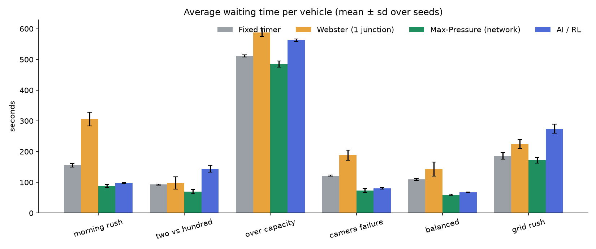
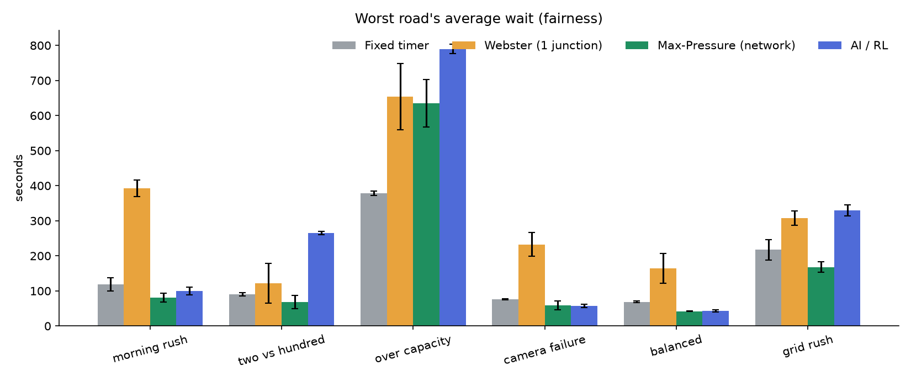
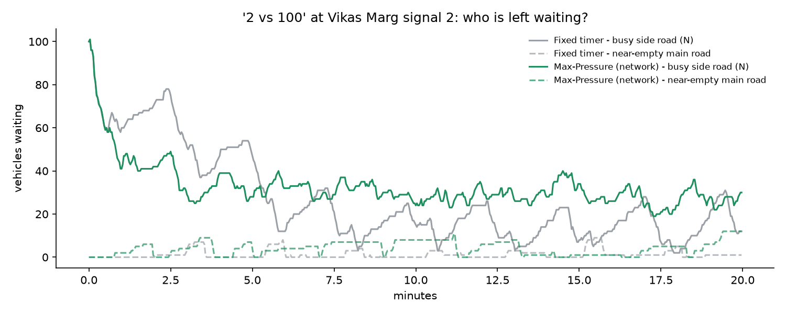
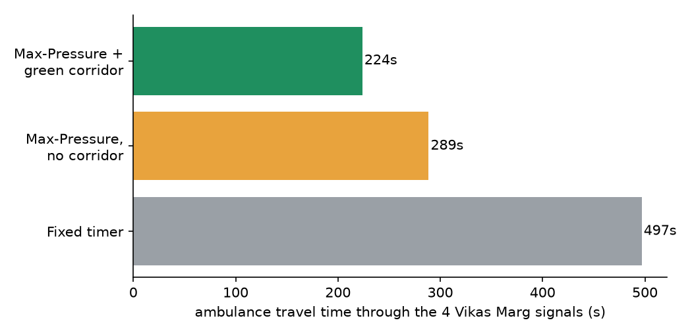

# Network signal-control results

_Generated by `scripts/make_network_report.py` (5 seeds per cell, mean ± sd). These are **simulation** results on the Vikas Marg corridor (4 real signals from OpenStreetMap) and a 2x2 grid with typical Indian peak-hour volumes, not field measurements._

| scenario | Fixed timer | Webster (1 junction) | Max-Pressure (network) | AI / RL |
|---|---|---|---|---|
| morning rush | 155 ± 6 s | 306 ± 22 s | 88 ± 5 s | 98 ± 1 s |
| two vs hundred | 93 ± 2 s | 98 ± 20 s | 70 ± 7 s | 144 ± 11 s |
| over capacity | 512 ± 4 s | 587 ± 12 s | 485 ± 10 s | 563 ± 4 s |
| camera failure | 122 ± 2 s | 189 ± 17 s | 74 ± 7 s | 80 ± 2 s |
| balanced | 109 ± 2 s | 143 ± 22 s | 60 ± 1 s | 68 ± 1 s |
| grid rush | 186 ± 10 s | 224 ± 14 s | 172 ± 9 s | 275 ± 15 s |

Average waiting time per vehicle. Worst-road wait (fairness):

| scenario | Fixed timer | Webster (1 junction) | Max-Pressure (network) | AI / RL |
|---|---|---|---|---|
| morning rush | 118 s | 392 s | 80 s | 100 s |
| two vs hundred | 90 s | 121 s | 68 s | 266 s |
| over capacity | 379 s | 654 s | 635 s | 790 s |
| camera failure | 76 s | 232 s | 59 s | 57 s |
| balanced | 69 s | 164 s | 42 s | 43 s |
| grid rush | 217 s | 308 s | 168 s | 330 s |

## Ambulance green corridor

- Fixed timer: 496.8 s
- Max-Pressure without corridor: 288.6 s
- Max-Pressure with green corridor: 223.8 s

## Robustness (morning rush, average wait)

| condition | Fixed | Max-Pressure |
|---|---|---|
| ideal cameras | 136 s | 82 s |
| 15% missed detections | 136 s | 79 s |
| turn ratios 30% wrong (learning on) | 136 s | 77 s |
| turn ratios 30% wrong (learning off) | 136 s | 75 s |
| chaotic lane discipline | 138 s | 81 s |

