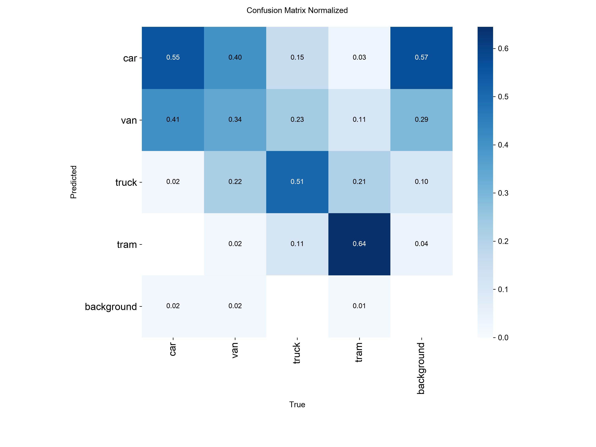
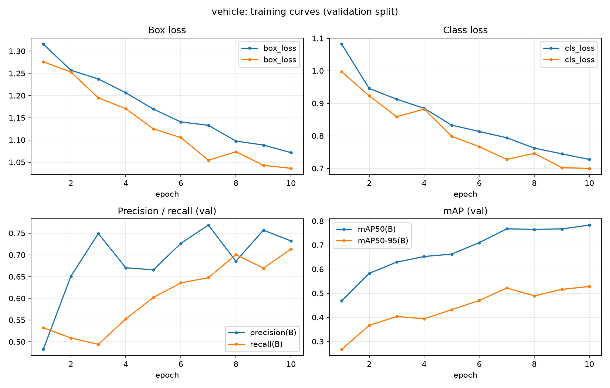
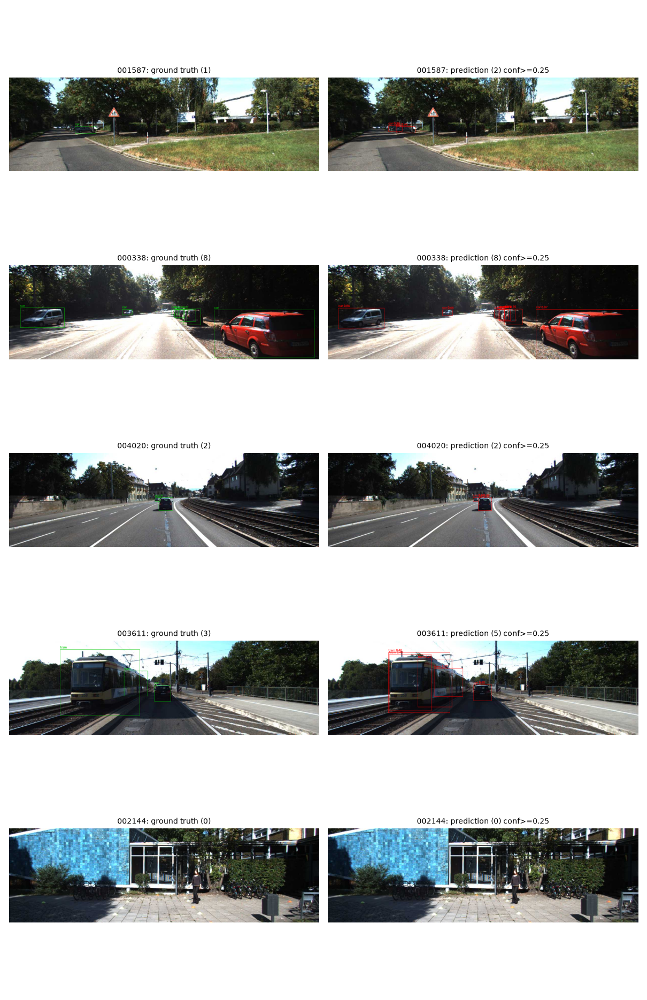
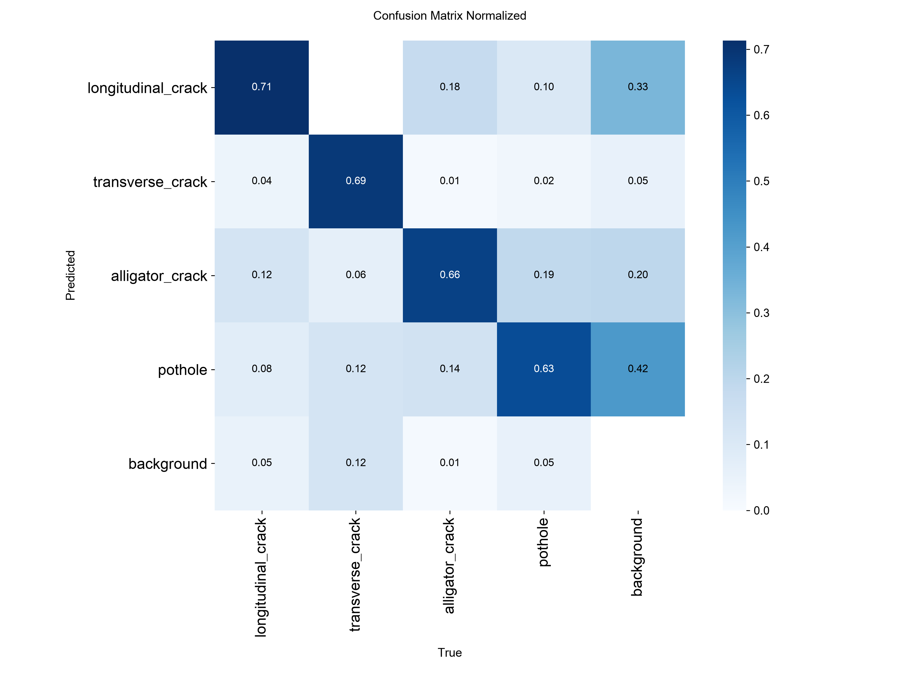
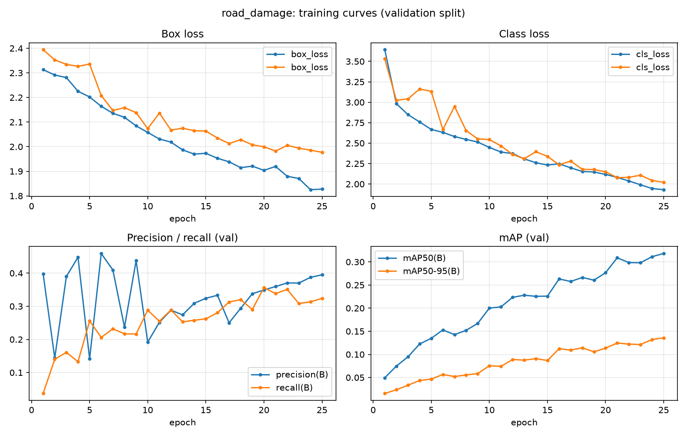
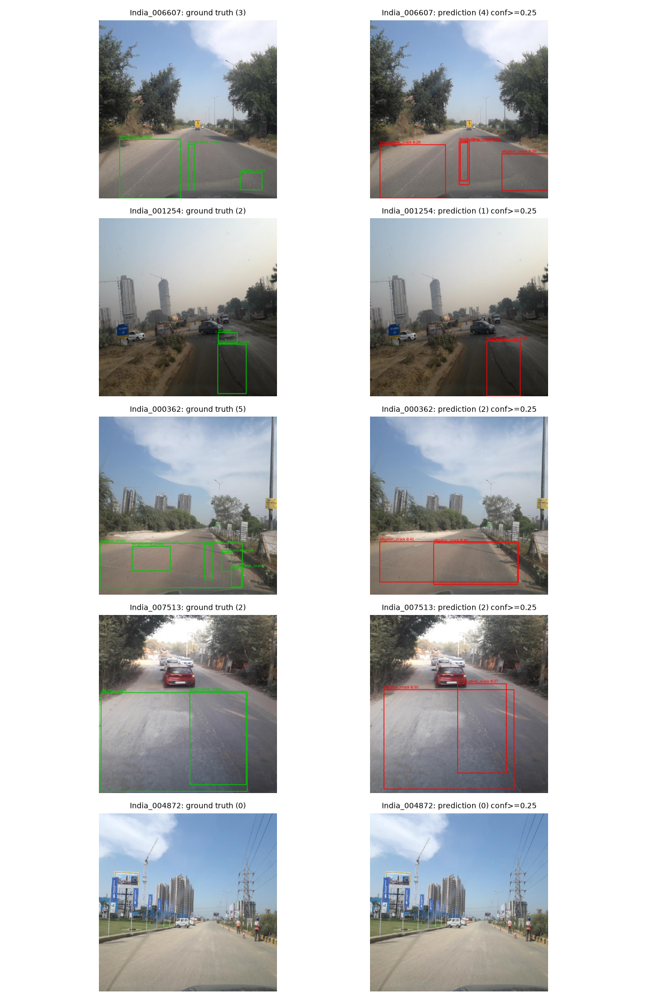
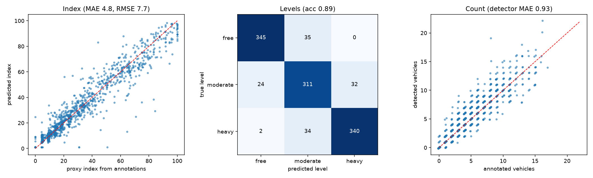

# Results

_Generated by `ml/evaluation/make_results.py` from files in `reports/`._

## Vehicle detection (KITTI)

Weights `/Users/aaditagarg/Downloads/smart-city/models/vehicle_best.pt` (26.5 MB), trained for 10 epochs, image size 640, evaluated on the held-out **test** split (1123 images) on `mps`.

| class | images | instances | precision | recall | f1 | mAP50 | mAP50-95 | low_support |
|---|---|---|---|---|---|---|---|---|
| car | 1011 | 4285 | 0.834 | 0.872 | 0.853 | 0.909 | 0.649 |  |
| van | 323 | 447 | 0.598 | 0.718 | 0.652 | 0.703 | 0.472 |  |
| truck | 155 | 169 | 0.822 | 0.746 | 0.782 | 0.830 | 0.595 |  |
| tram | 52 | 76 | 0.710 | 0.671 | 0.690 | 0.762 | 0.428 |  |
| ALL (macro) | 1123 | 4977 | 0.741 | 0.752 | 0.744 | 0.801 | 0.536 |  |

- Latency on `mps` (batch 1, includes image loading and NMS): mean 7.7 ms, median 7.9 ms, p95 12.1 ms (~130.0 FPS), n=100.
- Latency on `cpu` (batch 1, includes image loading and NMS): mean 13.5 ms, median 13.4 ms, p95 14.3 ms (~74.0 FPS), n=100.

## Road damage detection (RDD2022 India)

Weights `/Users/aaditagarg/Downloads/smart-city/models/road_damage_best.pt` (5.5 MB), trained for 25 epochs, image size 512, evaluated on the held-out **test** split (647 images) on `mps`.

| class | images | instances | precision | recall | f1 | mAP50 | mAP50-95 | low_support |
|---|---|---|---|---|---|---|---|---|
| longitudinal_crack | 184 | 265 | 0.480 | 0.234 | 0.315 | 0.314 | 0.117 |  |
| transverse_crack | 14 | 16 | 0.391 | 0.188 | 0.254 | 0.163 | 0.049 | yes |
| alligator_crack | 273 | 316 | 0.621 | 0.544 | 0.580 | 0.578 | 0.250 |  |
| pothole | 232 | 496 | 0.541 | 0.343 | 0.420 | 0.394 | 0.137 |  |
| ALL (macro) | 647 | 1093 | 0.508 | 0.327 | 0.392 | 0.362 | 0.138 |  |

Low-confidence classes (fewer than 30 test instances): transverse_crack.

- Latency on `mps` (batch 1, includes image loading and NMS): mean 10.4 ms, median 10.4 ms, p95 12.3 ms (~96.3 FPS), n=100.
- Latency on `cpu` (batch 1, includes image loading and NMS): mean 22.3 ms, median 22.3 ms, p95 22.9 ms (~44.8 FPS), n=100.

## Congestion estimation (proxy target)

Target = index computed from ANNOTATED vehicles (count + image coverage); the model predicts it from detector outputs. Fitted on the val split, scored on test. It measures how well detections reproduce annotated density, not human-rated congestion. Selected model: random_forest (n_val=1122, n_test=1123).

| metric | learned model | detector-only baseline |
|---|---|---|
| index MAE (0-100) | 4.814 | 5.177 |
| index RMSE (0-100) | 7.660 | 8.830 |
| level accuracy | 0.887 | 0.870 |
| level macro F1 | 0.887 | 0.869 |
| vehicle count MAE (raw detector) | – | 0.928 |
| vehicle count RMSE (raw detector) | – | 1.512 |

